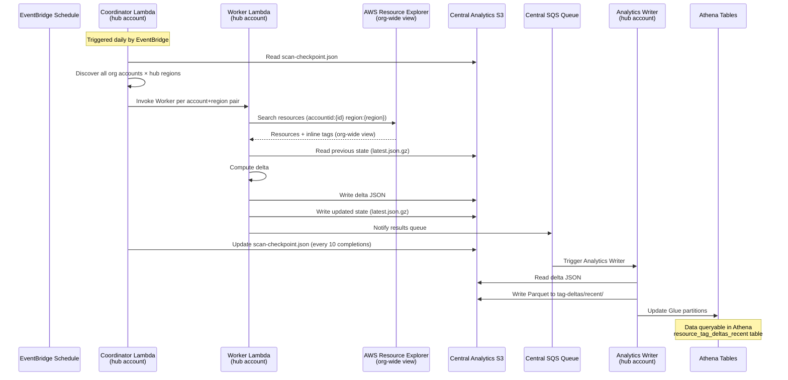
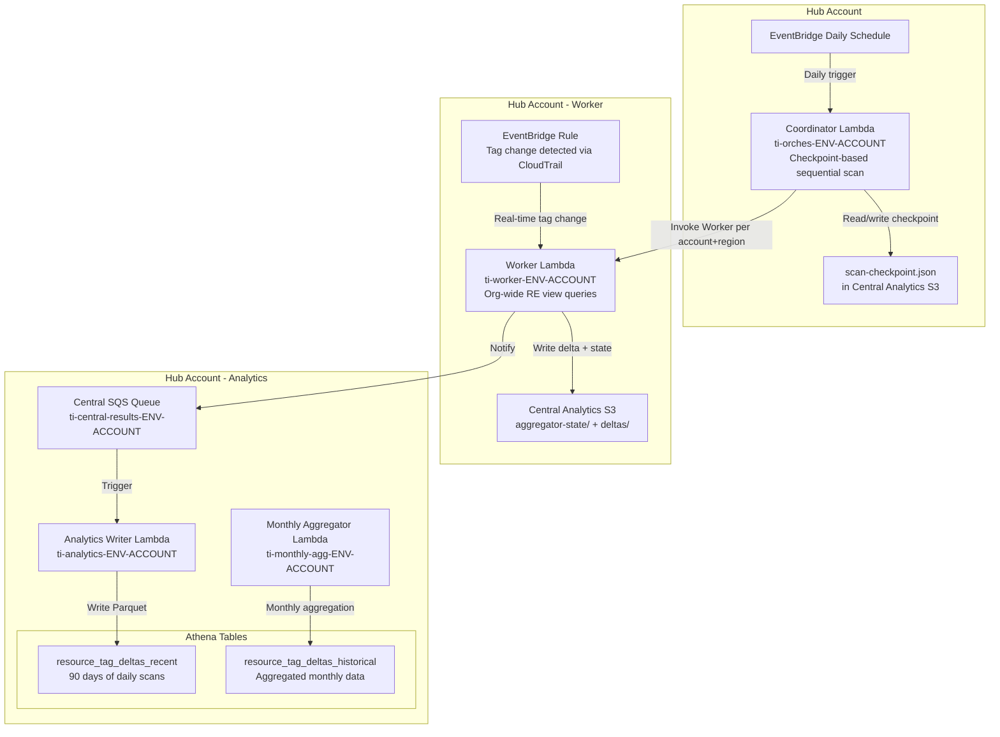
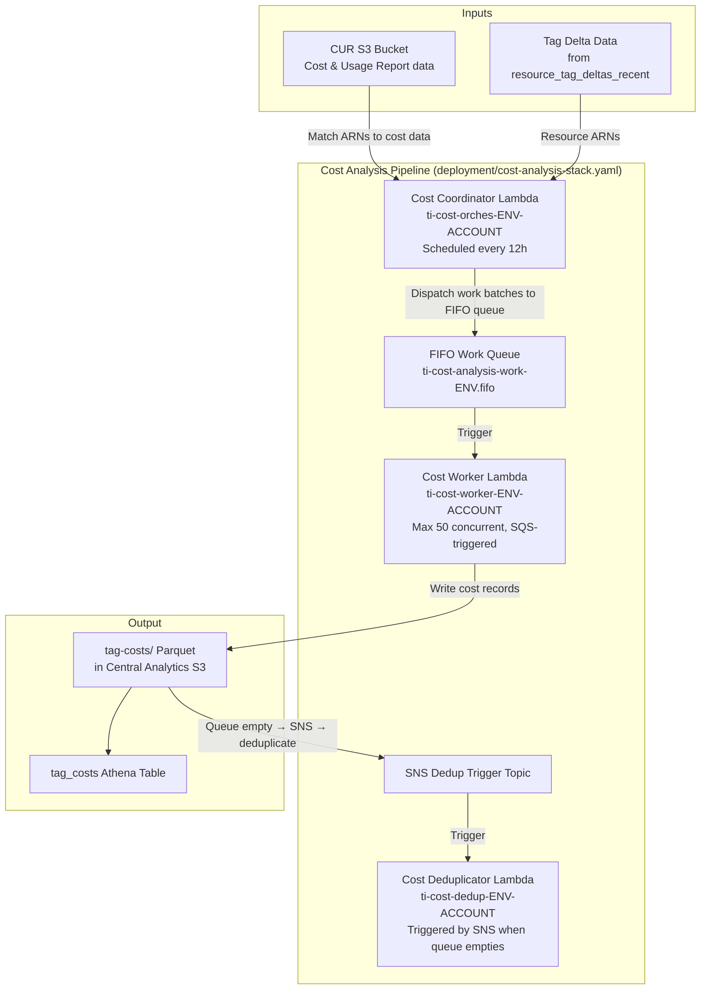
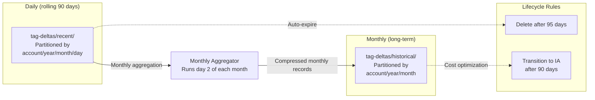

# TagInsights - Data Orchestration Guide

This document describes the complete data flow through TagInsights, what each Lambda function does, and how to trigger
them manually.

---

## Overview: End-to-End Data Flow



---

## Tag Collection Pipeline



---

## Cost Analysis Pipeline



**Key design notes:**

- Work queue is **FIFO** with content-based deduplication (prevents duplicate work)
- **Deduplication triggered via SNS topic** when queue depth reaches 0
- **`EnableCostExplorerFallback=false` by default** — opt-in required for CE fallback (prevents unexpected $0.01/request
  charges)
- **`CurAccountRoleArn` parameter** — cross-account CUR access via STS AssumeRole

---

## Monthly Data Lifecycle



---

## Lambda Reference

### Coordinator

**Function:** `ti-orches-{ENV}-{ACCOUNT_ID}`  
**Account:** Hub account  
**Trigger:** EventBridge daily schedule

**What it does:**

1. Reads `aggregator-state/scan-checkpoint.json` from S3 — resumes in-progress cycle or starts new one (`scan_id` =
   today's date)
2. Discovers all org accounts via AWS Organizations API
3. Cross-products all org accounts × hub regions to build the work list
4. **Sequential scan** (default): invokes Worker synchronously per pair, saves checkpoint every 10 completions; stops
   and saves checkpoint before Lambda timeout
5. **Fan-out mode** (if scan age ≥ `MAX_SCAN_DAYS`): invokes all remaining Workers asynchronously in parallel
6. On full completion: writes completion marker, deletes checkpoint

**Manual trigger:**

```bash
aws lambda invoke \
  --function-name ti-orches-prod-ACCOUNT_ID \
  --cli-binary-format raw-in-base64-out \
  --payload '{"trigger_source": "manual"}' \
  /tmp/response.json --profile ${AWS_PROFILE} && cat /tmp/response.json
```

---

### Worker

**Function:** `ti-worker-{ENV}-{ACCOUNT_ID}`  
**Account:** Hub account only (uses org-wide Resource Explorer view)  
**Trigger:** Coordinator invocation (scan path) or EventBridge tag change rule (real-time path)

**What it does:**

1. Locates the org-wide Resource Explorer view (ARN contains `/org/`)
2. Queries Resource Explorer via boto3 — `resource-explorer-2:Search` with `accountid:{account} region:{region}` filter
3. Extracts tags inline from RE response `Properties[name=tags].Data` — no secondary API calls
4. Reads previous state from `aggregator-state/account_id={account}/region={region}/latest.json.gz`
5. Computes delta (new resources, changed tags, removed resources)
6. Writes delta JSON to `deltas/account_id={account}/region={region}/{timestamp}-{scan_id}.json`
7. Writes updated state (compressed JSON) to `latest.json.gz`
8. Sends notification to `ti-central-results-ENV-ACCOUNT` SQS queue to trigger Analytics Writer

**Real-time path** (EventBridge CloudTrail rule): extracts ARNs from CloudTrail event payload, updates only affected
resources.

**Manual trigger (scan path):**

```bash
aws lambda invoke \
  --function-name ti-worker-prod-ACCOUNT_ID \
  --cli-binary-format raw-in-base64-out \
  --payload '{"account_id": "ACCOUNT_ID", "region": "us-east-1", "scan_id": "manual", "trigger_source": "manual"}' \
  /tmp/response.json --profile ${AWS_PROFILE} && cat /tmp/response.json
```

---

### Analytics Writer

**Function:** `ti-analytics-{ENV}-{ACCOUNT_ID}`  
**Account:** Hub account  
**Trigger:** Central SQS queue (triggered automatically after Worker writes deltas and notifies queue)

**What it does:**

1. Reads delta JSON from central analytics S3 bucket
2. Writes Parquet to `tag-deltas/recent/account_id=X/year=Y/month=M/day=D/`
3. Updates Glue table partitions for immediate Athena queryability
4. Handles SQS retries with progressive delay for S3 eventual consistency
5. Deduplicates writes using SHA-256 content hash as filename

**Manual trigger (reprocess pending):**

```bash
aws lambda invoke \
  --function-name ti-analytics-prod-ACCOUNT_ID \
  --cli-binary-format raw-in-base64-out \
  --payload '{"trigger_source": "manual"}' \
  /tmp/response.json --profile ${AWS_PROFILE}
```

---

### Monthly Aggregator

**Function:** `ti-monthly-agg-{ENV}-{ACCOUNT_ID}`  
**Account:** Hub account  
**Trigger:** EventBridge cron — `0 3 2 * ? *` (3 AM day 2 of each month)

**What it does:**

1. Discovers accounts with data for the target month (S3 listing, Athena fallback)
2. Aggregates daily records into monthly summaries: `first_seen`, `last_seen`, `change_count`
3. Writes aggregated Parquet to `tag-deltas/historical/account_id=X/year=Y/month=M/`
4. Deletes aggregated daily Glue partitions and S3 data

**Manual trigger:**

```bash
aws lambda invoke \
  --function-name ti-monthly-agg-prod-ACCOUNT_ID \
  --cli-binary-format raw-in-base64-out \
  --payload '{"trigger_source": "manual"}' \
  /tmp/response.json --profile ${AWS_PROFILE}
```

---

### Cost Coordinator

**Function:** `ti-cost-orches-{ENV}-{ACCOUNT_ID}` (if `EnableCostAnalysis=true`)  
**Account:** Hub account  
**Trigger:** EventBridge every 12 hours

**What it does:**

1. Reads resource ARNs from tag delta data
2. Dispatches batches to FIFO work queue (`ti-cost-analysis-work-ENV.fifo`)
3. Cost Workers pick up batches and match ARNs against CUR data via Athena
4. When queue drains to 0, SNS topic fires → triggers Deduplicator

**Manual trigger:**

```bash
aws lambda invoke \
  --function-name ti-cost-orches-prod-ACCOUNT_ID \
  --cli-binary-format raw-in-base64-out \
  --payload '{"trigger_source": "manual", "lookback_hours": 12}' \
  /tmp/response.json --profile ${AWS_PROFILE}
```

**Prerequisites:**

- CUR configured in AWS Billing with resource IDs and Athena integration
- `CurDatabaseName` + `CurTableName` stack parameters set
- For cross-account CUR: `CurAccountRoleArn` parameter set (see [cost-analysis/README.md](cost-analysis/README.md))

---

### Cost Worker

**Function:** `ti-cost-worker-{ENV}-{ACCOUNT_ID}` (if `EnableCostAnalysis=true`)  
**Account:** Hub account  
**Trigger:** FIFO SQS work queue (event source mapping, batch size 5, max concurrency 50)

**What it does:**

1. Receives batch of resource ARNs from FIFO queue
2. Normalizes ARNs to CUR `line_item_resource_id` format (service-specific)
3. Queries CUR Athena table for cost data
4. Writes results as Parquet to `tag-costs/`

---

### Cost Deduplicator

**Function:** `ti-cost-dedup-{ENV}-{ACCOUNT_ID}` (if `EnableCostAnalysis=true`)  
**Account:** Hub account  
**Trigger:** SNS topic subscription (triggered when cost work queue empties)

**What it does:**

1. Scans `tag-costs/` for duplicate records from overlapping runs
2. Uses Athena CTAS deduplication
3. Retains most recent version of each resource's cost data

---

## Trigger Sequence for Initial Data Population

```bash
ENV="prod"
REGION="us-east-1"
HUB_ACCOUNT=$(aws sts get-caller-identity --query Account --output text --profile ${AWS_PROFILE})

# Step 1: Trigger the Coordinator to start the first scan cycle
aws lambda invoke \
  --function-name ti-orches-${ENV}-${HUB_ACCOUNT} \
  --region ${REGION} \
  --cli-binary-format raw-in-base64-out \
  --payload '{"trigger_source": "manual"}' \
  /tmp/step1.json --profile ${AWS_PROFILE} && echo "Coordinator started" && cat /tmp/step1.json

# Step 2: Wait for scan to complete (Coordinator invokes Workers sequentially)
# For large orgs this may span multiple daily invocations
# Check progress:
aws s3 cp s3://ti-central-analytics-${REGION}-${ENV}-${HUB_ACCOUNT}/aggregator-state/scan-checkpoint.json -

# Step 3: Wait for Analytics Writer to process (auto-triggered via SQS, ~2-5 min)
echo "Waiting 5 minutes for Analytics Writer to process..."
sleep 300

# Step 4: Register Athena partitions
aws athena start-query-execution \
  --query-string "MSCK REPAIR TABLE resource_tag_deltas_recent" \
  --query-execution-context "Database=ti_${REGION}_${ENV}_${HUB_ACCOUNT}" \
  --work-group "ti-${REGION}-${ENV}-${HUB_ACCOUNT}" \
  --region ${REGION} \
  --profile ${AWS_PROFILE}

# Step 5: Verify data
aws athena start-query-execution \
  --query-string "SELECT COUNT(*), account_id FROM resource_tag_deltas_recent GROUP BY account_id" \
  --query-execution-context "Database=ti_${REGION}_${ENV}_${HUB_ACCOUNT}" \
  --work-group "ti-${REGION}-${ENV}-${HUB_ACCOUNT}" \
  --region ${REGION} \
  --profile ${AWS_PROFILE}

# Step 6: Trigger cost analysis (if EnableCostAnalysis=true)
aws lambda invoke \
  --function-name ti-cost-orches-${ENV}-${HUB_ACCOUNT} \
  --region ${REGION} \
  --cli-binary-format raw-in-base64-out \
  --payload '{"trigger_source": "manual", "lookback_hours": 24}' \
  /tmp/step6.json --profile ${AWS_PROFILE} && echo "Cost analysis started" && cat /tmp/step6.json
```

---

## Monitoring

Check CloudWatch logs for each Lambda:

```bash
# Coordinator (hub account)
aws logs tail /aws/lambda/ti-orches-prod-ACCOUNT --since 1h --profile ${AWS_PROFILE}

# Worker (hub account — scans all org accounts via org-wide RE view)
aws logs tail /aws/lambda/ti-worker-prod-ACCOUNT --since 1h --profile ${AWS_PROFILE}

# Analytics Writer (hub account)
aws logs tail /aws/lambda/ti-analytics-prod-ACCOUNT --since 1h --profile ${AWS_PROFILE}

# Monthly Aggregator (hub account)
aws logs tail /aws/lambda/ti-monthly-agg-prod-ACCOUNT --since 24h --profile ${AWS_PROFILE}

# Cost Coordinator (hub account)
aws logs tail /aws/lambda/ti-cost-orches-prod-ACCOUNT --since 1h --profile ${AWS_PROFILE}
```

Check scan checkpoint progress:

```bash
aws s3 cp s3://ti-central-analytics-REGION-prod-ACCOUNT/aggregator-state/scan-checkpoint.json - \
  | python3 -m json.tool
# Shows: scan_id, completed_count/total_count, errors
```

Check SQS queue depth (should drain to 0 after Analytics Writer processes):

```bash
aws sqs get-queue-attributes \
  --queue-url https://sqs.us-east-1.amazonaws.com/ACCOUNT/ti-central-results-prod-ACCOUNT \
  --attribute-names ApproximateNumberOfMessages,ApproximateNumberOfMessagesNotVisible \
  --profile ${AWS_PROFILE}
```

Check cost analysis FIFO queue:

```bash
aws sqs get-queue-attributes \
  --queue-url https://sqs.us-east-1.amazonaws.com/ACCOUNT/ti-cost-analysis-work-prod.fifo \
  --attribute-names ApproximateNumberOfMessages,ApproximateNumberOfMessagesNotVisible \
  --profile ${AWS_PROFILE}
```
